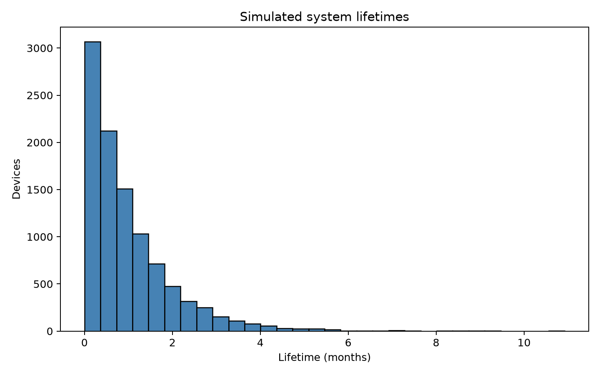

# Lab 7 - Chapter 4: Simulation, Bootstrap, and Error Propagation

Exercises covered: 4.1-4.5. The exercise statements and supplied worked solutions are in the [local Chapter 4 PDF](<statistics_exercises_ch4_solution.pdf>) and the [DTU exercise PDF](https://02323.compute.dtu.dk/enotes/exercises4-Python.pdf).

The runnable Python script is saved beside this answer as [lab_7_simulations.py](<lab_7_simulations.py>). Run `python3 lab_7_simulations.py` from this folder. It prints the simulation and bootstrap results and saves the Exercise 4.1 histogram beside the script. If pandas is installed, Exercise 4.1 stores the component lifetimes in the requested DataFrame; without pandas, a NumPy fallback runs the same calculations.

## Exercise 4.1 - Reliability: System Lifetime

There are three components in series: the device works only while **all three** work. Their independent lifetimes are exponential:

$$
X_A\sim\operatorname{Exp}(\lambda_A=1/2),\quad
X_B\sim\operatorname{Exp}(\lambda_B=1/3),\quad
X_C\sim\operatorname{Exp}(\lambda_C=1/5).
$$

For an exponential distribution, the mean lifetime is $1/\lambda$. In SciPy, stats.expon uses scale $=1/\lambda$, so the scales are 2, 3, and 5 months.

### (a) Simulate 10,000 component lifetimes and report the first three devices

Use a seed so the pseudorandom draws can be reproduced. Generate one lifetime from each component distribution per device and place the three columns in a DataFrame. The script uses the same seed and draw order as the supplied solution.

The simulated component lifetimes and device lifetime $Y$ for the first three devices are:

| Device | $X_A$ (months) | $X_B$ (months) | $X_C$ (months) | Device lifetime $Y$ (months) |
| ---: | ---: | ---: | ---: | ---: |
| 0 | 0.320960 | 4.895210 | 11.179703 | 0.320960 |
| 1 | 0.491043 | 3.006795 | 4.386929 | 0.491043 |
| 2 | 1.608826 | 1.485084 | 0.929437 | 0.929437 |

These are simulation outcomes, not fixed lifetimes. Changing the seed changes the particular rows.

### (b) Check the simulated component means

For 10,000 simulations, the means are:

| Component | Theoretical mean (months) | Simulated mean (months) |
| --- | ---: | ---: |
| A | 2 | 2.003508 |
| B | 3 | 3.026452 |
| C | 5 | 5.047804 |

They are close to their model means. With a finite number of simulated observations, exact equality is not expected.

### (c) Calculate each device lifetime and plot its distribution

The system stops working at the **first** component failure. Therefore:

$$
Y=\min(X_A,X_B,X_C).
$$

In pandas, take the minimum across columns for each row (axis=1). A row-wise minimum matters here: taking a column minimum would return only one minimum for each component type.

The simulation histogram is:

It is strongly right-skewed: most devices fail relatively early, while a smaller number last longer.

### (d)-(h) Summaries of the simulated device lifetime

From the 10,000 simulated device lifetimes:

| Quantity | Simulation estimate |
| --- | ---: |
| Mean lifetime | 0.988002 months |
| Sample standard deviation | 0.995923 months |
| Probability of failure by 1 month, $\widehat P(Y\leq1)$ | 0.639100 |
| Median lifetime | 0.687854 months |
| 10th percentile | 0.103483 months |

For the failure probability, make an indicator equal to 1 when $Y\leq1$ and 0 otherwise. The average of these indicators is the fraction of simulated devices that failed by month 1. The median and percentile are read from the simulated distribution; the percentile method used by the source solution is stated in the Python file.

### (i) What distribution does the system lifetime follow?

The histogram suggests an exponential distribution. We can check this from the model. For $y\geq0$, independence gives:

$$
\begin{aligned}
P(Y>y)
&=P(X_A>y,X_B>y,X_C>y)\\
&=P(X_A>y)P(X_B>y)P(X_C>y)\\
&=e^{-y/2}e^{-y/3}e^{-y/5}
=e^{-(31/30)y}.
\end{aligned}
$$

This is the survival function of an exponential distribution with rate:

$$
\lambda_Y=\frac12+\frac13+\frac15=\frac{31}{30}.
$$

Thus the theoretical mean and standard deviation are both:

$$
E(Y)=\operatorname{SD}(Y)=\frac{1}{\lambda_Y}=\frac{30}{31}\approx0.967742\text{ months}.
$$

The simulated mean 0.9880 and standard deviation 0.9959 are reasonably close. The exact probability of failure by one month is $1-e^{-31/30}\approx0.6433$, also close to the simulated 0.6391.

## Exercise 4.2 - Basic Percentile Bootstrap CI

The exercise supplies 1,000 ordered bootstrap means. Write $\bar{x}^{*(i)}$ for the $i$th smallest simulated mean. A central confidence interval uses the corresponding lower and upper tail percentiles.

For this exercise, when the percentile position lands exactly on an integer index, the source's convention averages that ordered value with the next one.

### (a) 95% bootstrap confidence interval

A 95% interval leaves $2.5\%$ in each tail:

$$
0.025(1000)=25,\qquad 0.975(1000)=975.
$$

So average ordered values 25 and 26 for the lower endpoint, and values 975 and 976 for the upper endpoint:

$$
q_{0.025}=\frac{38.3818+38.3818}{2}=38.3818,
$$

$$
q_{0.975}=\frac{38.5382+38.5391}{2}=38.53865\approx38.5387.
$$

Therefore:

$$
\boxed{CI_{95\%}=[38.3818,\ 38.5387]\text{ MPa}.}
$$

### (b) 90% bootstrap confidence interval

A 90% interval leaves $5\%$ in each tail:

$$
0.05(1000)=50,\qquad 0.95(1000)=950.
$$

$$
q_{0.05}=\frac{38.3909+38.3918}{2}=38.39135\approx38.3914,
$$

$$
q_{0.95}=\frac{38.5218+38.5236}{2}=38.5227.
$$

Thus:

$$
\boxed{CI_{90\%}=[38.3914,\ 38.5227]\text{ MPa}.}
$$

It is narrower because a 90% interval needs to include less of the bootstrap distribution than a 95% interval. The trade-off is lower confidence in exchange for a narrower interval.

## Exercise 4.3 - Different Bootstrap Confidence Intervals

The 11 observed strengths, in MPa, are:

$$
38.43,\ 38.43,\ 38.39,\ 38.83,\ 38.45,\ 38.35,\ 38.43,\ 38.31,\ 38.32,\ 38.48,\ 38.50.
$$

Here $n=11$, $\bar{x}=38.447273$, and the sample standard deviation is $s=0.141074$ MPa. The script uses 10,000 bootstrap samples, as allowed by the exercise, and the same seed as the source solution. A percentile bootstrap interval is the 2.5th and 97.5th percentiles of the simulated statistic.

### (a) Non-parametric bootstrap CI for the mean

For each replicate, sample 11 observed strengths **with replacement**, compute their mean, and store it. Resampling with replacement allows a value to appear multiple times and some original values not to appear in a replicate.

The resulting percentile interval is approximately:

$$
\boxed{CI_{95\%}(\mu)=[38.3818,\ 38.5355]\text{ MPa}.}
$$

This is close to the supplied solution's rounded summary of about $[38.38,38.54]$ MPa.

### (b) Normal parametric bootstrap CI for the mean; compare with the t interval

Assume the data are normally distributed. Fit the normal model using $\bar{x}$ and $s$. For every replicate, simulate 11 values from $N(\bar{x},s^2)$ and calculate their mean.

The normal parametric bootstrap gives:

$$
CI_{95\%,\text{normal bootstrap}}(\mu)\approx[38.3620,\ 38.5300]\text{ MPa}.
$$

For comparison, the classical one-sample $t$ interval is:

$$
\bar{x}\pm t_{0.975,10}\frac{s}{\sqrt{n}}
=38.4473\pm2.228\frac{0.1411}{\sqrt{11}}
\approx[38.3525,\ 38.5420]\text{ MPa}.
$$

Both are centred near $\bar{x}$ and give similar conclusions, but they are not identical. The simulated normal means use a roughly 1.96 standard-error percentile range; the classical interval uses the larger $t_{0.975,10}\approx2.228$ critical value to account for estimating the standard deviation from a small sample.

### (c) Log-normal parametric bootstrap CI for the mean

Fit a log-normal distribution by taking logarithms of the observations:

$$
Z_i=\ln(X_i),\qquad \hat\mu_{\log}=\bar Z,\qquad \hat\sigma_{\log}=s_Z.
$$

Simulate 11 values from the fitted log-normal distribution in each replicate, compute the original-scale mean, and take the 2.5th and 97.5th percentiles:

$$
\boxed{CI_{95\%,\text{log-normal bootstrap}}(\mu)
\approx[38.3629,\ 38.5314]\text{ MPa}.}
$$

This interval depends on the assumption that the population follows a log-normal distribution.

### (d) Normal parametric bootstrap CI for the lower quartile $Q_1$

For each replicate, generate 11 values from the fitted normal distribution and calculate the sample 25th percentile. Taking the 2.5th and 97.5th percentiles of those simulated quartiles gives:

$$
\boxed{CI_{95\%,\text{normal bootstrap}}(Q_1)
\approx[38.2611,\ 38.4656]\text{ MPa}.}
$$

This interval reflects the fitted normal model, including its assumption about the population shape.

### (e) Non-parametric bootstrap CI for $Q_1$

Now resample the 11 observed strengths with replacement and calculate the 25th percentile in every resample. The result is:

$$
\boxed{CI_{95\%,\text{non-parametric bootstrap}}(Q_1)
\approx[38.3150,\ 38.4300]\text{ MPa}.}
$$

The non-parametric method resamples only values present in the data, whereas the normal parametric method can generate new values. The intervals differ because they represent different assumptions. Both are bootstrap estimates and may vary slightly with the number of replicates, random seed, and percentile convention.

## Exercise 4.4 - Comparing Two Independent TV-Rating Samples

The two independent samples are:

$$
x_1=(1,2,1,3,2,1,2,3,1,1),\qquad
x_2=(3,4,2,4,2,3,2,4,3,2).
$$

Each group has 10 consumers. Their sample means are $\bar{x}_1=1.7$ and $\bar{x}_2=2.9$, so:

$$
\bar{x}_1-\bar{x}_2=1.7-2.9=-1.2\text{ rating points}.
$$

The negative sign means the observed average rating is higher for TV screen 2.

### (a) Non-parametric bootstrap comparison

For every replicate, sample 10 ratings with replacement from screen 1 and independently sample 10 with replacement from screen 2. Calculate $\bar{x}_1^*-\bar{x}_2^*$ and repeat 10,000 times.

The percentile 95% interval is:

$$
\boxed{CI_{95\%}(\mu_1-\mu_2)\approx[-1.90,\ -0.50].}
$$

Zero is not in the interval, so the percentile-bootstrap comparison rejects $H_0:\mu_1-\mu_2=0$ at the approximate 5% level. The interval is entirely negative, consistent with a higher average for screen 2.

### (b) Two-sample t test

Using a Welch test, which does not require equal population variances:

$$
H_0:\mu_1-\mu_2=0,\qquad H_1:\mu_1-\mu_2\ne0.
$$

The standard error is:

$$
SE=\sqrt{\frac{s_1^2}{n_1}+\frac{s_2^2}{n_2}}
=\sqrt{\frac{0.8233^2}{10}+\frac{0.8756^2}{10}}
\approx0.3801.
$$

Therefore:

$$
t=\frac{-1.2-0}{0.3801}\approx-3.157,\qquad df\approx17.93,\qquad p\approx0.00547.
$$

Since $p<0.05$, reject $H_0$. The data provide evidence of a difference in mean ratings; the observed difference favours screen 2.

**Source-code detail:** the supplied solution describes this as a Welch test, but its displayed call stats.ttest_ind(x1, x2) leaves SciPy's default equal_var=True in effect, which is the pooled-variance test. To run Welch, specify equal_var=False. For these data, the pooled call gives $p\approx0.00545$ and Welch gives $p\approx0.00547$; both lead to the same decision.

The ratings are discrete ordinal scores from 1 to 5. The t-test's continuous normal model is therefore an approximation. The non-parametric bootstrap resamples the actually observed rating values, so it avoids assuming a continuous normal population, though it still relies on the observed samples representing the groups.

### (c) Normal parametric bootstrap comparison

Fit a normal distribution separately to each screen's data. In each replicate, simulate 10 ratings from each fitted normal distribution and calculate the difference in their means. The percentile interval is:

$$
\boxed{CI_{95\%,\text{normal bootstrap}}(\mu_1-\mu_2)
\approx[-1.954,\ -0.443].}
$$

Zero is outside this interval, so it also rejects equality of means at the approximate 5% level. This is a model-based comparison and should be interpreted cautiously because the original ratings are discrete and ordinal.

## Exercise 4.5 - Non-linear Error Propagation

For one mole of ideal gas:

$$
PV=8.31T,
$$

where $P$ is in kPa, $V$ is in litres, and $T$ is in kelvin. The measurement standard deviations are treated as independent, as required for the formula below.

For a function $f(X_1,X_2)$ of independent measurements:

$$
\sigma_f\approx
\sqrt{\left(\frac{\partial f}{\partial x_1}\right)^2\sigma_1^2+
\left(\frac{\partial f}{\partial x_2}\right)^2\sigma_2^2}.
$$

Evaluate the derivatives at the measured values. This is a first-order approximation to the output standard deviation.

### (a) Estimate $T$ from measured $P$ and $V$

Rearrange:

$$
T=f(P,V)=\frac{PV}{8.31}.
$$

Estimate:

$$
\hat T=\frac{(240.48)(9.987)}{8.31}
=289.0101\approx289.01\text{ K}.
$$

The partial derivatives are:

$$
\frac{\partial T}{\partial P}=\frac{V}{8.31},\qquad
\frac{\partial T}{\partial V}=\frac{P}{8.31}.
$$

Substitute the measurement SDs:

$$
\begin{aligned}
\sigma_{\hat T}
&\approx\sqrt{\left(\frac{9.987}{8.31}\right)^2(0.03)^2+
\left(\frac{240.48}{8.31}\right)^2(0.002)^2}\\
&=0.06819\approx0.0682\text{ K}.
\end{aligned}
$$

### (b) Estimate $V$ from measured $P$ and $T$

Rearrange:

$$
V=f(P,T)=\frac{8.31T}{P},\qquad
\hat V=\frac{(8.31)(289.12)}{240.48}
=9.99080\approx9.9908\text{ L}.
$$

The derivatives are $\partial V/\partial T=8.31/P$ and $\partial V/\partial P=-8.31T/P^2$. Thus:

$$
\begin{aligned}
\sigma_{\hat V}
&\approx\sqrt{\left(\frac{8.31}{240.48}\right)^2(0.02)^2+
\left(\frac{8.31(289.12)}{240.48^2}\right)^2(0.03)^2}\\
&=0.001425\approx0.00143\text{ L}.
\end{aligned}
$$

The derivative with respect to $P$ is negative because increasing pressure while holding temperature fixed decreases volume. Its sign disappears after squaring in the variance formula.

### (c) Estimate $P$ from measured $V$ and $T$

Rearrange:

$$
P=f(V,T)=\frac{8.31T}{V},\qquad
\hat P=\frac{(8.31)(289.12)}{9.987}
=240.5715\approx240.57\text{ kPa}.
$$

The derivatives are $\partial P/\partial T=8.31/V$ and $\partial P/\partial V=-8.31T/V^2$. Therefore:

$$
\begin{aligned}
\sigma_{\hat P}
&\approx\sqrt{\left(\frac{8.31}{9.987}\right)^2(0.02)^2+
\left(\frac{8.31(289.12)}{9.987^2}\right)^2(0.002)^2}\\
&=0.050970\approx0.0510\text{ kPa}.
\end{aligned}
$$

### (d) Verify by simulation

The exercise's part (c) is simulated. Generate independent measurement errors:

$$
V^{(j)}\sim N(9.987,0.002^2),\qquad
T^{(j)}\sim N(289.12,0.02^2),
$$

then compute $P^{(j)}=8.31T^{(j)}/V^{(j)}$ for each of 10,000 repetitions. The script gives:

| Quantity | Value |
| --- | ---: |
| Simulated mean pressure | 240.5718 kPa |
| Simulated sample SD | 0.05120 kPa |
| First-order estimate from (c) | 0.05097 kPa |

The simulated spread is close to the first-order calculation. Small differences are expected because simulation uses a finite number of draws and the propagation formula linearises a nonlinear function.

## Calculator and Python Notes

- A TI-30XB can handle the arithmetic in Exercise 4.2 and substitute values into the formulas in Exercise 4.5. Keep parentheses around each derivative term and square the complete term.
- The TI-30XB cannot generate bootstrap samples or Monte Carlo simulations. Use the companion Python script for Exercises 4.1, 4.3, 4.4(a,c), and 4.5(d).
- For Exercise 4.4(b), the calculator can find the sample means, standard deviations, standard error, and $t$ statistic. Use a $t$ table or Python/SciPy for the two-sided $p$-value and Welch degrees of freedom.
- Simulation and bootstrap results are estimates. A seed makes the supplied code reproducible; it does not remove Monte Carlo variation or validate the assumptions.

## Source

[Uploaded Chapter 4 exercises and solutions](<statistics_exercises_ch4_solution.pdf>) · [DTU Chapter 4 Python exercise PDF](https://02323.compute.dtu.dk/enotes/exercises4-Python.pdf)
