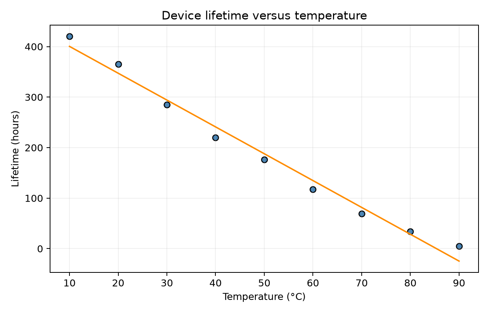
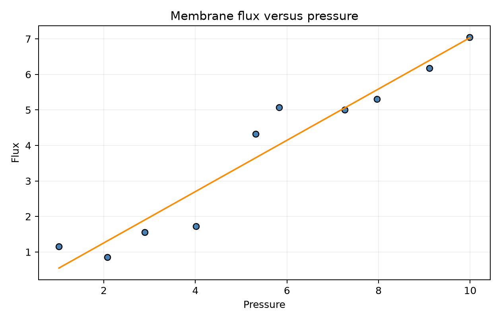

# Lab 8 - Chapter 5: Simple Linear Regression

Exercises covered: 5.1-5.6. The supplied exercise and solution PDF is in the course repository's Week 8/Exercises folder; the exercise statements are also on the [DTU Chapter 5 exercise page](https://02323.compute.dtu.dk/enotes/exercises5-Python.pdf).

The runnable computations and plots are in [lab_8_regression.py](<lab_8_regression.py>). Run `python3 lab_8_regression.py` from this folder. It needs NumPy, pandas, Matplotlib, SciPy, and statsmodels. The script saves scatterplots beside itself.

## Regression essentials

For paired observations $(x_i,y_i)$, simple linear regression models the mean response as a straight line plus random error:

$$
Y_i=\beta_0+\beta_1x_i+\varepsilon_i,\qquad \varepsilon_i\sim N(0,\sigma^2).
$$

Here $\beta_0$ is the population intercept, $\beta_1$ is the expected change in $Y$ for one-unit increase in $x$, and $\sigma$ describes the scatter of observations around the line. The least-squares estimates are

$$
\hat\beta_1=\frac{S_{xy}}{S_{xx}}
=\frac{\sum_i(x_i-\bar x)(y_i-\bar y)}{\sum_i(x_i-\bar x)^2},\qquad
\hat\beta_0=\bar y-\hat\beta_1\bar x.
$$

The fitted value is $\hat y_i=\hat\beta_0+\hat\beta_1x_i$ and residual $e_i=y_i-\hat y_i$. The residual standard deviation is

$$
s=\hat\sigma=\sqrt{\frac{\sum e_i^2}{n-2}}.
$$

For a slope confidence interval or test, use $n-2$ degrees of freedom and $SE(\hat\beta_1)=s/\sqrt{S_{xx}}$. A confidence interval for the *mean response* at $x_0$ uses standard error $s\sqrt{1/n+(x_0-\bar x)^2/S_{xx}}$. A prediction interval for one *new observation* adds the extra observation error: $s\sqrt{1+1/n+(x_0-\bar x)^2/S_{xx}}$. Do not confuse these intervals: prediction intervals are wider.

### TI-30XB guidance

Enter paired values in the calculator's data lists, then choose 2-Var Stats or LinReg $ax+b$ in the STAT-REG menu. It reports the regression slope $a$, intercept $b$, correlation $r$, and $r^2$; note its equation is displayed as $y=ax+b$, unlike the course convention $\hat y=\hat\beta_0+\hat\beta_1x$. Thus $a=\hat\beta_1$ and $b=\hat\beta_0$. The TI-30XB is useful for checking these estimates, correlation, and fitted values. For residual standard deviations, coefficient standard errors, p-values, and $t$-based confidence/prediction intervals, use the formulas with the course $t$ table or the provided Python script. It does not make the scatterplot; use Python or graph paper.

## Exercise 5.1 - Plastic film folding machine

The plot shows thickness falling from about 130 at $T=130^\circ C$ to about 80 at $T=185^\circ C$. This is a negative trend, with slope roughly

$$
\frac{80-130}{185-130}\approx -0.91
$$

thickness units per degree. Extrapolating the line back to $T=0$ gives an intercept around $130-(-0.9)(130)=247$, close to 252. The scatter around the fitted line is a few units, not dozens.

### (a) Select the plausible parameter estimates

The positive slope options do not fit the downward trend. An intercept of 0 is incompatible with a line near thickness 130 around $130^\circ C$. Between the remaining choices, $\hat\sigma=36$ is far too large for the small vertical scatter in the figure; $3.6$ is plausible.

$$
\boxed{\text{Choice 3: }\hat\beta_0=252,\quad\hat\beta_1=-0.9,\quad\hat\sigma=3.6.}
$$

### (b) Choose explained variation and correlation

The trend is strong, so 0% or 50% explained variation is implausibly low. The association is negative, so the correlation must be negative. The points are close to, but not exactly on, a line: $r$ should be close to $-1$, but not exactly $-1$.

$$
\boxed{\text{Choice 5: }R^2=96\%,\quad r=-0.98.}
$$

## Exercise 5.2 - Linear regression lifetime model

The paired data are temperature $t$ in Celsius and device lifetime $y$ in hours. The scatterplot in the supplied solution decreases approximately linearly, so fit $Y_i=\beta_0+\beta_1t_i+\varepsilon_i$.

### (a) Describe and estimate the relationship

The least-squares line is

$$
\hat y=453.5556-5.3133t.
$$

The slope means the estimated *average* lifetime decreases by about $5.31$ hours for each $1^\circ C$ increase in temperature. It is a trend across this dataset, not a guarantee about every individual device. The fitted intercept is the model's estimated mean lifetime at $0^\circ C$; because zero is outside the observed 10-90$^\circ C$ range, that interpretation is extrapolation.

### (b) 95% confidence interval for the slope

There are $n=9$ pairs, so $df=n-2=7$. From the regression, $\hat\beta_1=-5.3133$ and $SE(\hat\beta_1)=0.25578$. The critical value is $t_{0.975,7}=2.365$.

$$
\begin{aligned}
\hat\beta_1\pm t_{0.975,7}SE(\hat\beta_1)
&=-5.3133\pm2.365(0.25578)\\
&=-5.3133\pm0.6048\\
&\boxed{[-5.9182,-4.7085]\text{ hours per }^\circ C.}
\end{aligned}
$$

We are 95% confident that the population slope is in this interval. Since all values are negative, the data support a decreasing mean lifetime with increasing temperature.

### (c) Is there a linear relationship at $\alpha=0.05$?

Test $H_0:\beta_1=0$ against $H_1:\beta_1\ne0$. The statistic is

$$
t=\frac{\hat\beta_1-0}{SE(\hat\beta_1)}=\frac{-5.3133}{0.25578}=-20.77,\qquad df=7.
$$

The two-sided p-value is $1.51\times10^{-7}<0.05$ (equivalently, the 95% slope interval does not contain 0). Reject $H_0$: there is strong evidence of a linear association between temperature and mean lifetime, with a negative slope.

### (d) Read the Python regression table

The `Intercept` row gives $\hat\beta_0=453.5556$ (SE $14.3936$); the `t` row gives slope $\hat\beta_1=-5.3133$ (SE $0.25578$). The slope row's test statistic is $-20.773$ and its p-value is $1.505\times10^{-7}$. Its confidence limits are the interval from part (b). The p-value in this row tests $H_0:\beta_1=0$, not whether the model is true or whether an individual device lasts a specified time. The residual estimate is $s=19.8128$ hours.

## Exercise 5.3 - Yield of chemical process

Use the five pairs $(x,y)$: temperature in $^\circ C$ and yield in grams. The fitted model from the data is

$$
\hat y=15.4+0.8x,\qquad s=1.9322\text{ g},\qquad R^2=0.9972.
$$

### (a) Is the relationship significant at 5%?

Test $H_0:\beta_1=0$ versus $H_1:\beta_1\ne0$. The regression output gives $t=32.733$, with $df=5-2=3$, and two-sided $p=0.0000627$.

$$
p=0.0000627<0.05\quad\Longrightarrow\quad\boxed{\text{Reject }H_0.}
$$

There is strong evidence that expected yield has a linear relationship with temperature. The estimated yield increases by $0.8$ g per degree Celsius.

### (b) 95% confidence interval for expected yield at $x_0=80^\circ C$

First calculate the point estimate:

$$
\hat y(80)=15.4+0.8(80)=79.4\text{ g}.
$$

For the *mean response* interval use $\bar x=50$, $S_{xx}=6250$, $s=1.9322$, $n=5$, $df=3$, and $t_{0.975,3}=3.182$:

$$
\begin{aligned}
SE_{\text{mean}}&=s\sqrt{\frac1n+\frac{(x_0-\bar x)^2}{S_{xx}}}
=1.9322\sqrt{\frac15+\frac{(80-50)^2}{6250}}=1.1333,\\
79.4\pm3.182(1.1333)&=79.4\pm3.6065.
\end{aligned}
$$

$$
\boxed{CI_{95\%}(E[Y\mid x=80])=[75.79,83.01]\text{ g}.}
$$

This interval concerns the average yield for all process runs at $80^\circ C$, not a single future run.

### (c) Upper quartile of the residuals

The fitted residuals in the original observation order are $-1.4, 2.6, -1.4, 0.6, -0.4$ g. Sort them:

$$
-1.4,\ -1.4,\ -0.4,\ 0.6,\ 2.6.
$$

With the exercise's rank rule, $np=5(0.75)=3.75$, so select the next rank, the 4th ordered value:

$$
\boxed{Q_3=0.6\text{ g}.}
$$

Use this stated rank convention; software quantile functions may interpolate under other conventions and return a different value.

## Exercise 5.4 - Plastic material

Fit impact strength $y$ (kJ/m$^2$) against cooling time $x$ (seconds). The estimates are $\hat\beta_0=49.6390$, $\hat\beta_1=-0.52136$, residual SD $s=0.5565$, and $SE(\hat\beta_1)=0.02898$. Here $n=4$, so only $df=2$ degrees of freedom are available.

### (a) 95% confidence interval for the slope

The critical value is $t_{0.975,2}=4.303$. Therefore

$$
\begin{aligned}
\hat\beta_1\pm t_{0.975,2}SE(\hat\beta_1)
&=-0.52136\pm4.303(0.02898)\\
&=-0.52136\pm0.12467\\
&\boxed{[-0.6460,-0.3967]\text{ kJ/m}^2\text{ per second}.}
\end{aligned}
$$

The negative slope means impact strength tends to decrease as cooling time increases.

### (b) Is there a relationship at 5%?

Test $H_0:\beta_1=0$ two-sided. The source regression gives $p=0.00308<0.05$, so reject $H_0$. Evidence supports a linear relationship between cooling time and mean impact strength. The interval in (a) also excludes 0.

### (c) Critical acceptance range when testing $H_0:\beta_1=-0.30$

For a two-sided level-$0.05$ test with $df=2$, the critical values are $\pm t_{0.975,2}=\pm4.303$. Thus the null is not rejected when the test statistic falls in

$$
\boxed{-4.303\le t\le4.303.}
$$

The statistic would be $t=(\hat\beta_1-(-0.30))/SE(\hat\beta_1)$; this part asks for the acceptance range, not whether the null is accepted for these data.

## Exercise 5.5 - Water pollution

Regress average concentration on distance from the source. The line is

$$
\hat y=11.664-0.244x,\qquad s=0.3480,\qquad R^2=0.8676.
$$

### (a) Estimate the intercept, slope, and error SD

Read the coefficients from the output and estimate error spread as $s=\sqrt{SSE/(n-2)}$ (or $\sqrt{\text{MSE}}$):

$$
\boxed{\hat\beta_0=11.664,\quad \hat\beta_1=-0.244,\quad \hat\sigma=s=0.348.}
$$

The slope estimates a decrease of $0.244$ concentration units per additional kilometre.

### (b) How much variation is explained?

The output has $R^2=0.8676$. Thus

$$
\boxed{86.8\%\text{ of the observed concentration variation is explained by its linear association with distance}.}
$$

The remaining approximately $13.2\%$ is not explained by this fitted linear model. $R^2$ describes this sample/model fit; it does not mean distance causes that percentage of pollution changes.

### (c) 95% confidence interval for mean concentration at 7 km

The predicted mean is

$$
\hat y(7)=11.664-0.244(7)=9.956\approx9.96.
$$

Here $n=5$, $df=3$, $\bar x=6$, $S_{xx}=40$, and $t_{0.975,3}=3.182$. The standard error for the *mean* at $x_0=7$ is

$$
SE_{\text{mean}}=0.348\sqrt{\frac15+\frac{(7-6)^2}{40}}=0.1651.
$$

$$
9.956\pm3.182(0.1651)=9.956\pm0.5254
\quad\Longrightarrow\quad
\boxed{[9.431,10.481]\approx[9.43,10.5].}
$$

This is an interval for the expected/average concentration at 7 km, not a range for one individual measurement.

## Exercise 5.6 - Membrane pressure drop

Use pressure $x$ and flux $y$ from the ten supplied pairs. A scatterplot rises roughly linearly. The sample correlation is

$$
\boxed{r=0.9638\approx0.964,}
$$

which is a strong positive association. The fitted line and residual SD are

$$
\hat y=-0.18857+0.72248x,\qquad s=0.64461,\qquad R^2=0.92895.
$$

### (a) Correlation and visual expectation

The correlation is positive and close to 1; the scatterplot also shows flux generally increasing with pressure. So the computed value matches the visual expectation. Correlation measures linear association, not causation.

### (b) 90% confidence interval for the slope

For $n=10$, $df=8$ and $t_{0.95,8}=1.860$. The slope estimate is $0.722476$ and its standard error is $0.070644$:

$$
\begin{aligned}
0.722476\pm1.860(0.070644)&=0.722476\pm0.13137,\\
&\boxed{[0.5911,0.8538]\text{ flux units per pressure unit}.}
\end{aligned}
$$

The supplied solution rounds the slope and its SE before substitution and reports approximately $[0.5905,0.8545]$. The small difference is rounding only. A 90% interval is narrower than a 95% interval because its critical value is smaller.

### (c) Fraction of flux variation not explained by pressure

The explained fraction is $R^2=0.92895$. Hence

$$
1-R^2=1-0.92895=0.07105
\quad\Longrightarrow\quad
\boxed{7.1\%\text{ is unexplained by the fitted linear model}.}
$$

### (d) Can we reject that the line passes through $(0,0)$?

Passing through the origin means $\beta_0=0$. Test $H_0:\beta_0=0$ versus $H_1:\beta_0\ne0$. The intercept row gives $p=0.681>0.05$, so

$$
\boxed{\text{Do not reject }H_0.}
$$

The data do not provide sufficient evidence that the intercept differs from zero. This does not prove the true intercept is exactly zero.

### (e) Estimated average flux at pressure 5 and 95% confidence interval

The fitted average is

$$
\hat y(5)=-0.188574+0.722476(5)=3.423806\approx3.424.
$$

For a confidence interval for the *mean flux*, use $df=8$, $t_{0.975,8}=2.306$, $\bar x=5.547$, $S_{xx}=83.25961$, and $s=0.64461$:

$$
SE_{\text{mean}}=s\sqrt{\frac1{10}+\frac{(5-5.547)^2}{83.25961}}=0.20747.
$$

$$
3.42381\pm2.306(0.20747)=3.42381\pm0.47843
\quad\Longrightarrow\quad
\boxed{CI_{95\%}(E[Y\mid x=5])=[2.945,3.902].}
$$

This describes uncertainty about the mean flux at pressure 5.

### (f) 95% prediction interval for one new flux reading at pressure 5

For a single future observation, include the extra $1$ inside the square root:

$$
SE_{\text{pred}}=s\sqrt{1+\frac1{10}+\frac{(5-5.547)^2}{83.25961}}=0.67737.
$$

$$
3.42381\pm2.306(0.67737)=3.42381\pm1.56202
\quad\Longrightarrow\quad
\boxed{PI_{95\%}=[1.862,4.986].}
$$

Interpretation: under the regression assumptions, a single new flux observation taken at pressure 5 is expected to fall in this interval with the method's 95% long-run coverage. It is wider than the mean-response interval because it includes both uncertainty in the estimated mean and the natural scatter of a new observation.

## Exam checks

- Label variables and units before substituting; slope units are response units per predictor unit.
- For simple regression, slope tests and intervals use $df=n-2$.
- $R^2$ is the proportion of sample response variation explained by the fitted line; $r$ has the sign of the slope.
- A confidence interval for the line's mean uses no leading $1$ under the square root. A prediction interval for a new observation does.
- A p-value is evidence against the stated null, not the probability that the null is true.
- Check whether a prediction is interpolation (within the observed $x$ range) or extrapolation (outside it).

## Source

Calculations and reported exercise conventions follow the supplied Chapter 5 exercise-solution PDF in `Week 8/Exercises/exercises_solutions5-Python.pdf`. Calculator menu capabilities were checked against the [official TI-30XS/TI-30XB guidebook](https://education.ti.com/html/eguides/discontinued/scientifics/EN/TI-30X-Plus-Multiview-Guidebook_EN.pdf).
