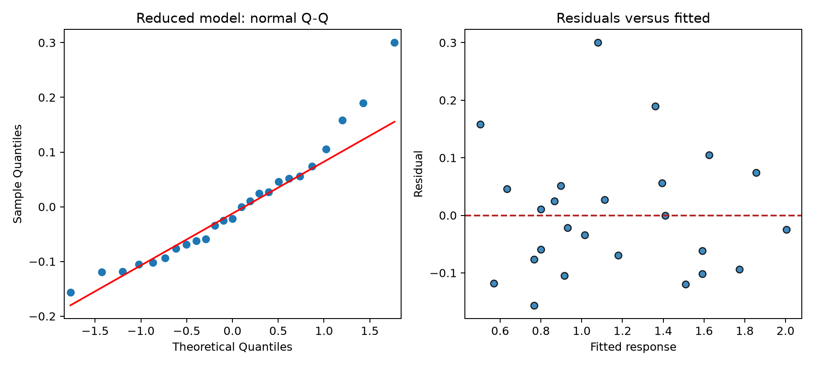
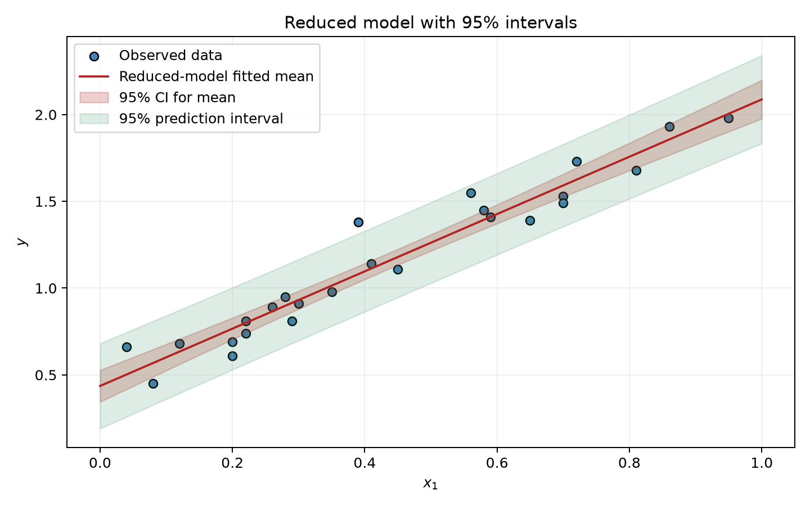

# Lab 9 - Chapter 6: Multiple Linear Regression

Exercises covered: 6.1 and 6.2. The supplied solution PDF is in the course repository's Week 9/Exercises folder. Exercise statements are also on the [DTU Chapter 6 page](https://02323.compute.dtu.dk/enotes/exercises6-Python.pdf).

The runnable analysis is in [lab_9_multiple_regression.py](<lab_9_multiple_regression.py>). Run `python3 lab_9_multiple_regression.py` from this folder. It uses NumPy, pandas, Matplotlib, SciPy, and statsmodels, and creates diagnostic and interval plots beside the script.

## Core idea: multiple regression

The model with predictors $x_1,\ldots,x_p$ is

$$
Y_i=\beta_0+\beta_1x_{1,i}+\cdots+\beta_px_{p,i}+\varepsilon_i,
\qquad \varepsilon_i\overset{ind}{\sim}N(0,\sigma^2).
$$

Each slope is a *partial effect*: $\beta_j$ describes the change in mean response for a one-unit increase in $x_j$ while the other predictors in the model are held fixed. The standard error for regression uses residual degrees of freedom $df=n-(p+1)$, counting the intercept. A coefficient test asks $H_0:\beta_j=0$ conditional on the other included predictors. A large p-value means insufficient evidence of an additional linear effect; it does not prove that the effect is exactly zero.

### TI-30XB

The TI-30XB can calculate simple two-variable regression, but it cannot fit this multiple regression model with two predictors or produce the required coefficient standard errors, p-values, and intervals. Use Python for the fits and inference in this lab. The calculator can still help with individual arithmetic checks, but it is not a substitute for the regression output.

## Exercise 6.1 - Nitrate concentration

The response $Y$ is log nitrate concentration; $x_1$ is log nitrate loading and $x_2$ is log fresh-water runoff. The supplied output is based on $n=240$ observations:

$$
\hat Y=-2.365+0.4762x_1+0.0827x_2,
\qquad R^2=0.3438.
$$

### (a) Estimates and standard errors

Read the `coef` and `std err` columns:

| Parameter | Estimate | Standard error |
|---|---:|---:|
| $\hat\beta_0$ | $-2.365$ | $0.222$ |
| $\hat\beta_1$ | $0.4762$ | $0.062$ |
| $\hat\beta_2$ | $0.0827$ | $0.070$ |

The standard errors measure sampling uncertainty in the coefficient estimates; they are not the residual SD $\hat\sigma$.

### (b) Degrees of freedom

There are $p=2$ predictors and one intercept, so three regression parameters are estimated:

$$
df=n-(p+1)=240-(2+1)=\boxed{237}.
$$

### (c) 95% confidence intervals

Use $\hat\beta_j\pm t_{0.975,237}SE(\hat\beta_j)$, with $t_{0.975,237}\approx1.970$.

$$
\begin{aligned}
\beta_0 &: -2.365\pm1.970(0.222)=-2.365\pm0.437=\boxed{[-2.802,-1.928]},\\
\beta_1 &: 0.476\pm1.970(0.062)=0.476\pm0.122=\boxed{[0.354,0.598]},\\
\beta_2 &: 0.083\pm1.970(0.070)=0.083\pm0.138=\boxed{[-0.055,0.221]}.
\end{aligned}
$$

The first two intervals exclude zero; the third includes zero.

### (d) Significance of each parameter

For each coefficient, test $H_{0,j}:\beta_j=0$ against $H_{1,j}:\beta_j\ne0$ at $\alpha=0.05$. The corresponding table p-values are:

| Coefficient | Test statistic | p-value | Decision |
|---|---:|---:|---|
| Intercept $\beta_0$ | $-10.661$ | $<0.0005$ (rounded to 0.000) | Reject $H_0$ |
| Loading $\beta_1$ | $7.720$ | $<0.0005$ (rounded to 0.000) | Reject $H_0$ |
| Runoff $\beta_2$ | $1.185$ | $0.237$ | Do not reject $H_0$ |

The 95% interval gives the same decisions: $\beta_0$ and $\beta_1$ are significantly different from zero; the data do not establish that $\beta_2$ differs from zero. This is a conditional test: runoff is assessed while nitrate loading remains in the model.

### (e) Why use logarithms?

Concentration, loading, and runoff are positive and often right-skewed. Logs compress large values and may make the relationship and residual spread more compatible with a linear model's assumptions. A log-log model also expresses a multiplicative relationship on the original scale:

$$
\log(C)=\beta_0+\beta_1\log(L)+\beta_2\log(R)+\varepsilon
\quad\Longleftrightarrow\quad
C=e^{\beta_0}L^{\beta_1}R^{\beta_2}e^\varepsilon.
$$

Holding runoff fixed, doubling loading multiplies the predicted concentration by $2^{0.4762}\approx1.39$, about a 39% increase. Logging does not automatically make assumptions true: residual plots should still be checked. Predictions are modeled on the log scale; exponentiating gives a positive original-scale value.

### (f) Regression assumptions: choose the one correct statement

The correct answer is **4**: errors are independent, normally distributed, and have constant variance. More precisely, $\varepsilon_i\sim N(0,\sigma^2)$, independently. The error realizations are not all zero; predictors are treated as known; and the coefficients are fixed model parameters, not normally distributed random variables.

### (g) Careful interpretation of the runoff result

The correct answer is **3**: after nitrate loading is included, these data do not show that runoff explains additional variation in log nitrate concentration. Since $p=0.237$, we do not reject $H_0:\beta_2=0$. We have *not* proven no effect, and 0.237 is not the probability that $H_0$ is true. The positive estimate alone is not sufficient evidence of a positive population effect.

## Exercise 6.2 - Multiple linear regression model

The 25 observations are fitted first with the full model $Y=\beta_0+\beta_1x_1+\beta_2x_2+\varepsilon$, then backward selection is applied at $\alpha=0.05$.

### (a) Fit the full model and calculate intervals

The reported coefficient estimates are:

$$
\hat y=0.4335+1.6530x_1+0.0039x_2.
$$

The residual standard deviation is $\hat\sigma=0.1127$, so the estimated error variance is

$$
\hat\sigma^2=(0.1127)^2\approx\boxed{0.0127}.
$$

The 95% confidence intervals from the regression output are:

| Parameter | Estimate | 95% confidence interval |
|---|---:|---:|
| $\beta_0$ | $0.4335$ | $[0.297,0.570]$ |
| $\beta_1$ | $1.6530$ | $[1.455,1.851]$ |
| $\beta_2$ | $0.0039$ | $[-0.151,0.159]$ |

The $x_2$ interval contains zero; the $x_1$ interval does not.

### (b) Backward selection

Start with the full model and remove the least significant predictor only if its p-value exceeds 0.05.

1. In the full model, $x_2$ has $p=0.958$, the largest predictor p-value; its confidence interval also includes zero. It is not significant at 5% after controlling for $x_1$.
2. Remove $x_2$ and refit $Y=\beta_0+\beta_1x_1+\varepsilon$.
3. The reduced-model estimates are $\hat\beta_0=0.4361$ and $\hat\beta_1=1.6512$. Both are significant (their reported intervals, $[0.345,0.527]$ and $[1.471,1.831]$, exclude zero).
4. The reduced model has $R^2=0.940$, essentially the same as the full model. Stop: neither remaining coefficient is insignificant.

The estimate of the $x_1$ slope barely changes, from 1.6530 to 1.6512. In this dataset, $x_2$ adds almost no explanatory value beyond $x_1$.

### (c) Residual analysis for the reduced model

Check two plots made by the script:

- In the normal Q-Q plot, residuals should lie approximately along a straight line if normality is plausible.
- In residuals versus fitted values, look for random scatter around zero with roughly constant vertical spread. A curve suggests a missing nonlinear pattern; a funnel suggests non-constant variance.

The supplied solution reports no strong evidence against the assumptions: the Q-Q points are approximately linear and there is no obvious residual-versus-fitted pattern. With only 25 observations, treat diagnostics as checks for conspicuous problems, not proof that assumptions hold.

### (d) Fitted line and 95% confidence/prediction intervals for $0\le x_1\le1$

For each $x_1$ in the interval, use the reduced model to calculate its fitted mean and two intervals. The confidence interval describes uncertainty about the *mean response*; the prediction interval covers a *single new response* and is wider because it also includes individual error. Both bands are narrowest near $\bar x_1=0.437$ and widen toward the edges.

The plot shows observed data, the fitted line, and both 95% bands. The vertical distance between prediction limits is **not constant**: like the confidence band, it narrows around the predictor mean and widens toward the range ends.

### (e) Which interval statement is false?

The false statement is **3**: it claims the prediction interval has constant width over $x$. Both intervals depend on the distance from $x$ to $\bar x$ and widen away from the center; the prediction interval is wider everywhere because its standard-error formula includes an additional $1$ under the square root.

## Quick exam reminders

- In multiple regression, interpret a slope while holding the other included predictors fixed.
- Degrees of freedom are $n-(p+1)$, including the intercept among fitted parameters.
- A coefficient p-value is conditional on the other variables in that model.
- Do not interpret “not significant” as proof of no effect or as the probability the null is true.
- A confidence interval is for the mean response; a prediction interval is for an individual new response and is wider.
- Inspect residual Q-Q and residual-versus-fitted plots before relying on normal-theory inference.

## Source

Worked results and answer conventions follow the supplied Chapter 6 exercise-solution PDF in `Week 9/Exercises/statistics_exercises_ch6_solution.pdf`; exercise statements are linked above.
